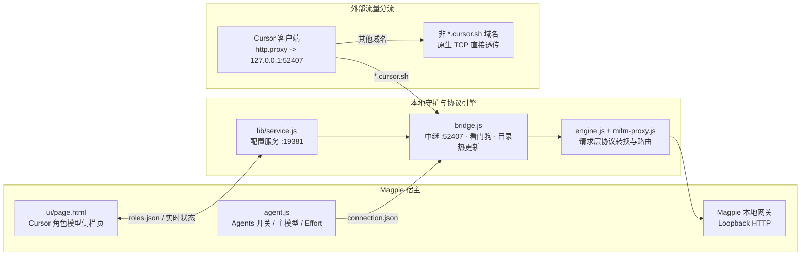

<div align="center">


# Cursor · Magpie Bridge

**零二进制 · 零第三方依赖的 Cursor ↔ Magpie 协议桥接插件**

*Clean-Room Shadow Implementation — 让 Cursor 原生 Agent 生态无缝接入 Magpie 模型目录与多路由能力*

<p>
  
  
  
  
  
</p>

<p>
  <a href="#核心特性">核心特性</a> ·
  <a href="#工作原理">工作原理</a> ·
  <a href="#快速开始">快速开始</a> ·
  <a href="#magpie-集成与分角色模型">分角色模型</a> ·
  <a href="#安全与隔离设计">安全与隔离</a> ·
  <a href="#常用命令与目录结构">命令与结构</a>
</p>

</div>

---

## 核心特性

| 维度 | 说明 |
| :--- | :--- |
| **原生 Agent 接入** | 直接接入 Cursor 原生 Agent（保留其本地上下文、工具执行、MCP 与沙箱机制），仅在请求层进行协议转换与模型路由转发。 |
| **目录与能力透传** | 实时拉取 Magpie 模型目录并热更新至 Cursor，按模型真实能力暴露上下文窗口、`efforts` 推理强度以及 `Fast` / `Ultrafast` 等多档 `serviceTiers` 加速等级。 |
| **分角色模型路由** | 在 Magpie 侧栏 **「Cursor 角色模型」** 页统一配置主对话之外的 9 类专用职责（含 Auto-review 权限审查与 `explore` / `shell` / `generalPurpose` / `browser-use` 子代理细分），保存后约 1 秒热生效。 |
| **零依赖洁净实现** | 纯 ESM JavaScript 编写，无 `node_modules`、无预编译可执行文件；内置 JSONC 编辑器、ASN.1 DER X.509 证书签发器与 Protobuf Wire 编解码器。 |
| **可信透明与隔离** | 全量核心文件由 `integrity.json` 做 SHA-256 校验；对话与上下文 Blob 仅驻留内存不落盘；仅本地 TLS 桥接 `*.cursor.sh`，其余域名原生 TCP 透传。 |

---

## 工作原理



1. **托管与唤醒**：Magpie 宿主通过 `plugin.js` 自动启动本地配置服务（默认 `http://127.0.0.1:19381`）并按需拉起或升级后台守护进程；`agent.js` 以纯 `moejs` 沙箱元数据在 **Agents** 列表中暴露 **Cursor · Magpie Bridge**。
2. **精确代理接管**：`bridge.js` 监听固定本机回环中继端口（默认 `52407`，冲突时自动回退并在释放后恢复），通过带日志的 JSONC 编辑器写入 Cursor `settings.json` 的 `http.proxy`，停用或卸载时精确还原原配置。
3. **请求层桥接与热重载**：`engine.js` 仅对 `*.cursor.sh` 签发本地 CA 叶子证书并拦截请求，在请求边界完成协议转换后路由至 Magpie 回环网关，不改动或重造 Cursor 原生 Agent 运行时；目录或角色变更无需重启 Cursor 即可热生效。

---

## 快速开始

### 运行环境要求

- **操作系统**：macOS（`arm64` / `x64`）或 Windows（`x64` / `arm64`）
- **运行时**：已安装 **Magpie**（自动探测内置 `magpie-bun`）或 **Node.js**（也可通过 `MAGPIE_BUN` 指定运行时路径）

### 安装与接入

```bash
# macOS：校验完整性、签发并信任本地 CA，注册 LaunchAgent 后台服务
bash setup.command
```

```powershell
# Windows（cmd 或 PowerShell）：校验完整性、导入本地 CA 并启动后台服务
setup.cmd
```

> [!NOTE]
> 首次安装阶段会生成本机独立的桥接根证书（`~/.config/magpie-cursor-bridge/data/ca/ca.crt`）并请求系统信任授权，弹出确认窗口时选择允许 / “是” 即可。

安装完成后：
1. 打开 **Magpie → Agents**，开启 **Cursor · Magpie Bridge** 并选择主模型与推理强度。
2. 无需重启 Cursor，即可在 Cursor 中直接看到 Magpie 同步的模型列表。

---

## Magpie 集成与分角色模型

本插件遵循 `yetone/magpie` 双模块规范：

- **Agents 行（`agent.js`）**：仅保留主开关、模型选择、推理强度（`effort`）与加速等级透传，保持主列表简洁。
- **插件侧栏页（`ui/page.html`）**：从 Magpie 侧栏插件分组进入 **「Cursor 角色模型」**，通过实时模型选择器按职责单独配置模型（支持附加 `[reasoning=low|medium|high|xhigh]`，留空则沿用主模型）：

| 配置字段 | 适用场景 / 对应 Cursor RPC | 默认行为 |
| :--- | :--- | :--- |
| `autoRouterModel` | Cursor 原生 `Auto` 模式的路由控制模型 | 留空默认使用 `cursor/auto`，失败时以 `cursor/auto-smart` 重试；无 Cursor 供应商时回退主模型 |
| `subagentModel` | 通用派生子代理（Explore / Shell / Task 等） | 留空沿用主模型 |
| `subagentTypeModels` | 按子代理类型细分：`explore` · `shell` · `generalPurpose` · `browser-use` | 留空沿用 `subagentModel` / 主模型 |
| `bugbotModel` | Bugbot 自动审阅、`StreamBugBot`、`StreamBugBotLinter`、`StreamDiffReview` | 留空沿用主模型 |
| `securitybotModel` | SecurityBot 安全审查与漏洞扫描子代理 | 留空沿用主模型 |
| `autoReviewModel` | Cursor Auto-review 权限模式下的命令与工具安全审查（`ClassifyAgentAutoReview`） | 留空沿用主模型 |
| `titleModel` | 会话与分支命名（`NameAgent`、`GetChatTitle`、`WriteGitBranchName`） | 留空沿用主模型 |
| `summarizeModel` | 长对话摘要与压缩（`SummarizeAction`、`CreateTranscriptOverview`、`GetConversationSummary`） | 留空沿用主模型 |
| `memoryModel` | 记忆提取与整理（`PotentiallyGenerateMemory` 及记忆子代理） | 留空沿用主模型 |
| `commitModel` | Git 提交信息生成（`WriteGitCommitMessage`） | 留空沿用主模型 |

> 在侧栏页点击保存后，配置会写入 `~/.config/magpie-cursor-bridge/roles.json`，后台约 **1 秒内热生效**，无需重启 Cursor 或 Magpie 宿主。

---

## 安全与隔离设计

- **零预编译二进制**：全链路均以可读 ESM JavaScript 运行于 Node.js 或 Magpie 内置 Bun，不含任何不透明可执行文件。
- **零第三方运行时依赖**：`package.json` 无外部 `dependencies`，JSONC 无损编辑、ASN.1 DER X.509 签发、Protobuf Wire 编解码全部独立实现。
- **源码完整性校验**：`integrity.json` 记录全部核心运行文件的 SHA-256 摘要，安装及版本切换时显式核验。
- **无落盘会话存储**：不创建本地 SQLite 数据库持久化用户提示词、响应或密钥；会话上下文与 Blob 仅驻留内存。
- **严格回环与最小拦截**：
  - 仅对 `*.cursor.sh` 执行本地 TLS 协议桥接，非 Cursor 域名通过原生 TCP 透传；
  - 遥测与部分账号/配置探针在本地隔离应答，减少不必要的外部上报；
  - Magpie 网关地址与诊断配置服务均强制校验为本机回环 HTTP（`127.0.0.1` / `localhost` / `::1`）。

---

## 常用命令与目录结构

### 常用命令

```bash
# 安装 / 更新插件与后台服务（Windows 请使用 setup.cmd 或 setup.ps1）
bash setup.command

# 查看后台运行状态（输出 ~/.config/magpie-cursor-bridge/status.json）
bash setup.command status

# 停用后台服务并精确还原 Cursor 的代理配置
bash setup.command uninstall

# 运行全量自动化测试（node --test）
npm test

# 更新 integrity.json 文件摘要清单（修改源码后执行）
npm run integrity
```

### 目录结构

```text
Magpie-cursor-agent/
├── agent.js              # Magpie Agents 纯沙箱元数据与能力声明
├── plugin.js             # Magpie Bun Plugin Host 主入口
├── bridge.js             # 后台守护、中继监听(:52407)、目录刷新与代理接管
├── engine.js             # 本地 TLS MITM 与 Cursor 协议引擎启动入口
├── install.js            # 跨平台校验、CA 信任、版本化发布与开机托管
├── setup.command / .cmd / .ps1
├── integrity.json        # 核心运行文件 SHA-256 完整性清单
├── lib/
│   ├── cursor-engine.js  # Cursor RPC 路由、Auto 路由、角色调度与模型目录
│   ├── inference-loop.js # RunInference 请求流转换与响应回传
│   ├── cursor-tools.js   # Cursor 工具调用编解码与 MCP 声明透传
│   ├── mitm-proxy.js     # *.cursor.sh TLS 终止与非 Cursor 域名 TCP 透传
│   ├── service.js        # 回环配置服务(:19381)与角色持久化
│   ├── config.js         # 回环校验、角色归一化、多档 service_tier 解析
│   ├── proto-wire.js     # 零依赖 Protobuf Wire 编解码与 schema 映射
│   ├── x509.js           # 本机 CA 与动态叶子证书签发器
│   └── jsonc.js / settings.js / lock.js / relay.js / magpie.js / watch.js
├── ui/
│   ├── page.html / .js   # Magpie「Cursor 角色模型」独立侧栏配置页
│   ├── panel.html / .js  # 独立管理面板页面
│   └── shared.js / style.css / icon.svg
├── scripts/
│   └── update-integrity.mjs
└── test/                 # 自动化单元测试（75 项用例）
```

---

<div align="center">
  <sub>Licensed under the <a href="./LICENSE">MIT License</a>.</sub>
</div>
